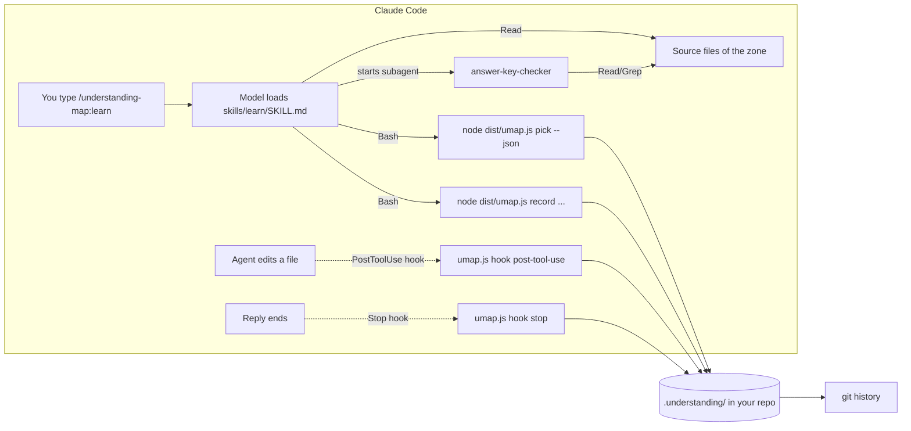

# How a Claude Code plugin works, using Understanding Map as the example

A Claude Code plugin is a folder that Claude Code reads when it starts. It does not run as a server, and it does not change the model. It adds behaviour in four ways:

| Part | What it is | What Claude Code does with it | In this plugin |
|---|---|---|---|
| **Manifest** | `.claude-plugin/plugin.json` | Reads the plugin's name, version and metadata. The name becomes the command prefix (`/understanding-map:…`). | `name: understanding-map` |
| **Skills** | `skills/<name>/SKILL.md`: a Markdown playbook with YAML frontmatter | Lists each skill's `description` for the model. When you type the slash command, or a request matches the description, Claude Code loads the full playbook into the conversation, and the model follows it using its normal tools (Bash, Read, …). | `setup`, `map`, `learn`, `handoff`, `who`, `visualize` |
| **Agents** | `agents/<name>.md`: a system prompt plus an allowed tool list | Lets the main model start a *subagent*: a fresh model instance with its own context and only the tools listed. It reports back once. | `answer-key-checker` (tools: Read, Grep, Glob) |
| **Hooks** | `hooks/hooks.json`: shell commands bound to lifecycle events | Runs the command itself, outside the model, whenever the event fires. It pipes event JSON to the command's stdin and reads JSON back from stdout. | `PostToolUse` on edits, `Stop` after each reply |

A plugin can also ship MCP servers (`.mcp.json`) and output styles. This one doesn't need either.

The key idea: **skills and agents are instructions for the model; hooks and scripts are ordinary code.** A good plugin puts each job on the right side of that line.

## Two halves: a deterministic engine and model-driven playbooks



**The engine** (`src/` → bundled into `dist/umap.js`, about 4,000 lines of TypeScript) is a plain Node CLI. It does everything that must be fast, repeatable and free:

- `git.ts` reads history: who changed which files, and which commits carry agent co-author trailers.
- `zones.ts` groups files into zones (one per folder, with big folders split and tiny ones merged).
- `imports.ts` finds how many other files import each zone, using a regex for each of 8 languages, and lists each import edge with its line number.
- `attribution.ts` and `editlog.ts` record which lines agents wrote.
- `scoring.ts` turns all of that into an understanding level per person per zone, a state (Owned / Fragile / Fading / Dark / Unknown) and a danger rank. Every number lives in `weights.ts`.
- `report.ts` writes the HTML treemap. `record.ts` saves session results.
- `context.ts`, `storyboard.ts`, `layout.ts` and `visual.ts` power `visualize`: a zone's neighbours and likely entry points, storyboard validation, box-and-text geometry, and the self-contained animation page.
- `cli.ts` exposes all of it as commands with `--json` output.

The engine never calls a model. That is why `map` takes about 0.2 s on a 100k-line repo and costs no tokens.

**The playbooks** (`skills/*/SKILL.md`) handle what needs language and judgement: explaining code, writing questions, grading free-text answers. Each playbook tells the model exactly which engine command to run, how to read its JSON, and what rules to follow, for example "never reveal an answer key before the user answers".

## What happens when you run `/understanding-map:learn`

1. **Load.** Claude Code injects `skills/learn/SKILL.md` into the conversation. The model now knows the 5-minute session procedure.
2. **Pick (engine).** The model runs `node <plugin>/dist/umap.js pick --json`. The engine rebuilds the map from git and `.understanding/` and returns the most dangerous zone with its evidence.
3. **Tour (model).** The model reads that zone's files with its Read tool and writes a short walkthrough with `file:line` references.
4. **Draft (model).** It writes three questions with answer keys: *predict* what happens, *break* it, and *locate* where to change something.
5. **Verify (subagent).** It starts `answer-key-checker`, a separate model instance that sees only the questions and the code. It can read but never edit. It re-derives each answer from the source and returns `{id, confirmed, reason}`. Unconfirmed questions are regenerated once; if fewer than two survive, you get the tour only. This is the guard against teaching you something false.
6. **Ask and grade (model).** Questions come one at a time, and each answer is graded pass, partial or miss with a cited explanation.
7. **Record (engine).** The model runs `umap.js record --kind session --zones "<zone>" --grades pass,partial,pass`. The engine applies the grading rule, appends a pass event (shared in team mode) or a local partial/miss, and prints `Result: pass` plus `payments: Dark → Owned`.

The model handles judgement; the engine owns state and the rules. The model can't quietly change a score, because only the engine writes to `.understanding/`.

## What happens when you run `/understanding-map:visualize`

The same split, applied to a picture:

1. **Context (engine).** `umap.js context "<zone>" --json` returns the zone, the zones that import it and that it imports (with the import lines and their line numbers) and files that look like entry points (routes, handlers, pages, `main`). This bounds what the model reads. With no argument it uses the zone of your last learning session.
2. **Cache (engine).** `umap.js visualize "<zone>" --cached --json` reuses the saved storyboard if none of the files it depends on has changed.
3. **Storyboard (model).** The model reads the zone and those neighbours and writes a small JSON storyboard: the journey of one user action through real zones, 3–7 steps inside the zone, and an optional gotcha, every item with a `file:line`.
4. **Verify (subagent).** `answer-key-checker` checks every hop, the zone's role, each step, their order and the gotcha. Unconfirmed items are regenerated once, then dropped; with fewer than 3 confirmed steps there is no visual.
5. **Render (engine).** `umap.js visualize "<zone>" --storyboard <file>` validates the storyboard (limits, refs inside the repository, steps inside the zone, journey stops on real zones), lays every box out in code at 1280 and 375 px wide, and writes one HTML file with an inlined, hand-written player. The model never writes HTML.

Nothing is recorded: watching never raises a level.

## What the hooks do, which the model never sees

- **`PostToolUse`** (matcher `Edit|Write|MultiEdit|NotebookEdit`) fires after every agent edit. Claude Code pipes JSON such as `{session_id, cwd, tool_name, tool_input, tool_response.structuredPatch}` to `umap.js hook post-tool-use`. The engine counts only the added (`+`) lines and appends one line to `.understanding/local/edits.jsonl`. That log is the most reliable record of what agents wrote. It runs in about 30 ms and always exits 0.
- **`Stop`** fires when a reply finishes. `umap.js hook stop` adds up the unchecked agent lines. Past 50, it prints `{"systemMessage": "Agents changed ~180 lines in 3 zones … run /understanding-map:handoff"}`, which Claude Code shows to you. It never returns `"decision": "block"`, so it can't stop or nag the agent.
- Both commands start with `command -v node … || true`. If Node is missing, the hook does nothing rather than failing on every edit.

Hooks are the right tool here because they're guaranteed and invisible. A skill only runs when the model chooses to; a hook runs on every event.

## Where state lives

Everything goes into `.understanding/` in your repo, which keeps the plugin stateless and portable:

```
.understanding/
  config.json            solo|team, critical paths, thresholds        (committed in team mode)
  .gitignore             what stays private                           (committed in team mode)
  events/<handle>.jsonl  passed sessions only, append-only            (committed in team mode)
  agent-share/<id>.jsonl anonymous {zone, agentLines, week} totals    (committed in team mode)
  local/                 edit log, failed attempts, flags, caches,    (never committed)
                         last-learn.json, visuals/<zone>.html + .json
  report.html            generated treemap                            (never committed)
```

Team mode is just git. Each person appends only to their own file, and `merge=union` in `.gitattributes` lets branches merge without conflicts. There's no server and no account.

## How Claude Code finds the engine

- **Hooks** get `${CLAUDE_PLUGIN_ROOT}`, the plugin's install folder, from Claude Code.
- **Skills** are told their own folder when they load ("Base directory for this skill: …"), so `SKILL.md` runs `node "<base>/../../dist/umap.js"`.
- The engine is committed already built (`dist/umap.js`, a single ESM file with every dependency inlined), so users install nothing. Node 18+ and git are the only requirements.

## How it's built and tested

```
src/*.ts  ──esbuild──▶  dist/umap.js        (npm run build)
test/*.test.ts  ──vitest──▶  423 tests      (npm test)
claude plugin validate .                    (manifest, skills, agents, hooks)
```

Tests build real throwaway git repos (`test/helpers/repo.ts`) and run the real CLI and bundle against them. There are no mocks of git, and none of the scoring rules.

## The design rules worth copying

1. **Keep state and rules in code; give language and judgement to the model.** Scores are reproducible, and the model can't make them up.
2. **Verify model output with a second, narrower agent** before a user sees it.
3. **Hooks must be fast, silent and impossible to fail.** Always exit 0, never block, and do nothing when not set up.
4. **Ship prebuilt and local-first.** No install step, no network by default, and data stays in the repo.
5. **Make every skill call the engine with `--json`**, so the playbook reads structured data instead of parsing prose.
